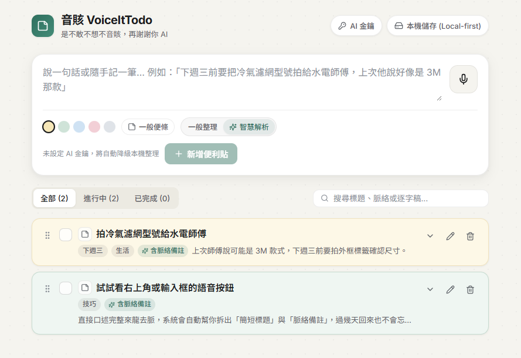

# 大方無虞 VoiceItTodo

> 「大方吾語，大方無虞」

現代化、語音優先（Voice-First）的極簡待辦便利貼應用，採用 **Local-first + BYOK AI + Headless Cloudflare** 架構設計，無需綁定信用卡即可免費部署上線。



## 💡 命名緣由

典出《老子》第四十一章：**「大方無隅，大器晚成，大音希聲，大象無形。」**

本專案與前作 **「大音悉聲」**（音訊處理）、**「大相無形」**（影像視覺）系出同源，構成三部曲之完滿篇章：

- **大方無虞**：
  2. **萬事無憂**：「無虞」意指毫無後顧之憂。待辦工具的終極價值，正是讓人在紛雜事務中放下焦慮，隨口交代、萬事妥貼、行事無虞。
- **大方吾語**：
  1. **吾語**：開口直言「吾之言語」，語音優先（Voice-First），擺脫繁瑣欄位打字的束縛。
  2. **大方吾語，大方無虞**：只要大方開口說出來，剩下的標題提煉、脈絡備註與標籤整理交由 AI 處理，自然成就心靈的平靜與無虞。
- **VoiceItTodo**：從便利貼 *PostIt* 轉化為用語音記錄的 *VoiceIt*，開口就能記下待辦。

## ✨ 核心設計理念

一般待辦工具分類過於繁瑣，而又限制只記一行字，過幾天回來往往忘記「當初為什麼要記這件事」。

**大方無虞 VoiceItTodo** 的解法：
- **語音快速捕捉**：內建 Web Speech API（`zh-TW`）即時語音輸入，打開即可口述。
- **自動拆解脈絡（一般整理 / 智慧解析）**：支援自備 AI 金鑰（BYOK：Ollama / Groq / Gemini / OpenAI / Claude）進行語意拆解，未設定金鑰時自動降級為本機整理，將口語拆成**精簡標題**、**脈絡備註**、**時間／情境標籤**，並保留**原始逐字稿**（漸進式展開查看，主畫面維持清爽）。
- **Local-first 免登入即用**：預設將資料儲存在瀏覽器本機，零延遲、離線可用。
- **Headless 雲端同步**：透過 `X-Space-Key` 隔離不同使用者空間，可選配連接 **Cloudflare Workers + D1** 實現跨裝置同步或供 iOS 捷徑等外部工具無頭寫入。

## 🛠️ 技術架構

### 前端（專案根目錄 `src/`）
- React 19 + TypeScript + Vite
- `@dnd-kit`（流暢拖曳排序）
- `lucide-react`（現代化圖示）
- Web Speech API（免後端成本的即時語音輸入）
- BYOK AI 解析（支援本機 Ollama 或各大雲端 LLM API）

### Headless 後端 (`worker/`)
- **Cloudflare Workers** + **Hono**（Edge API，零冷啟動）
- **Cloudflare D1**（Serverless SQLite，免費版 500 MB / 單庫、5 GB 總空間，免綁信用卡）
- **Cloudflare Workers AI**（選配，用於語意拆解強化）

## 🚀 本地開發

### 1. 啟動前端（純 Local-first 模式即可運作）
```bash
npm install
npm run dev
```

### 2. 啟動 Headless Worker（選配）
```bash
cd worker
npm install
npm run db:migrate:local
npm run dev
```

## ☁️ 部署到 Cloudflare（完全免費、免綁信用卡）

### 1. 部署 Headless API (Workers + D1)
```bash
cd worker
npx wrangler login
npx wrangler d1 create postittodo-db
# 將終端機顯示的 database_id 填入 worker/wrangler.toml
npm run db:migrate:remote
npm run deploy
```

### 2. 部署前端 (Cloudflare Pages)
1. 前往 Cloudflare Dashboard → **Workers & Pages** → **Create** → **Pages**，連接此 GitHub Repo。
2. 建置設定：
   - **Root directory**：留空（專案根目錄）
   - **Build command**: `npm run build`
   - **Build output directory**: `dist`
   - **環境變數（選填）**: `VITE_API_URL` = 你的 Worker 網址（例如 `https://voice-it-todo-api.xxx.workers.dev`）
